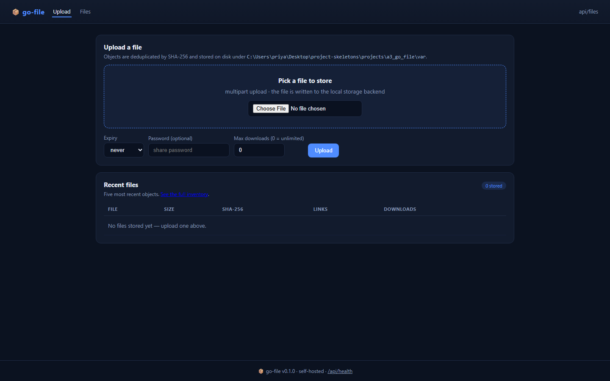
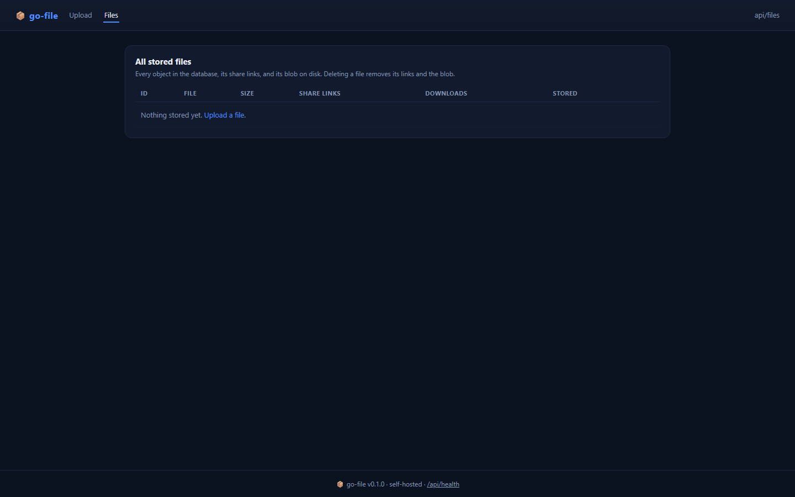
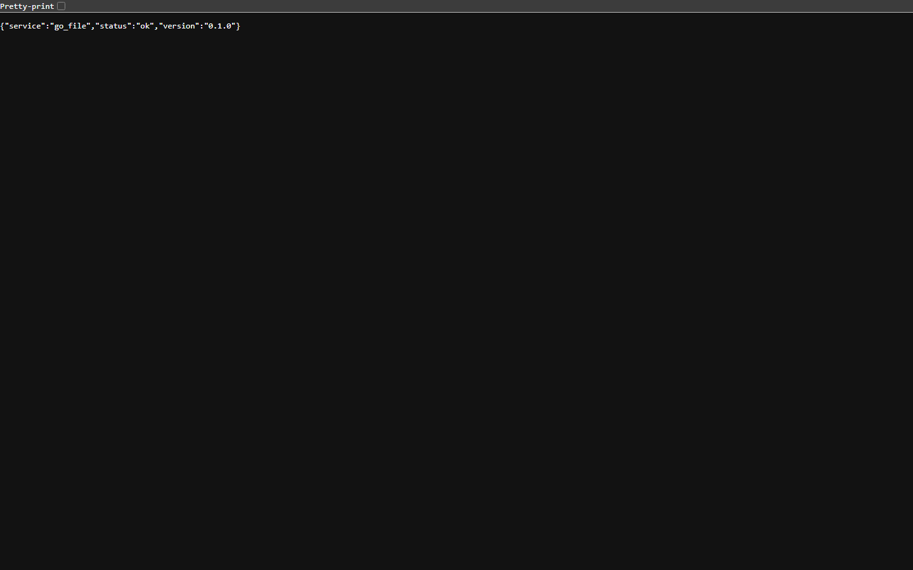
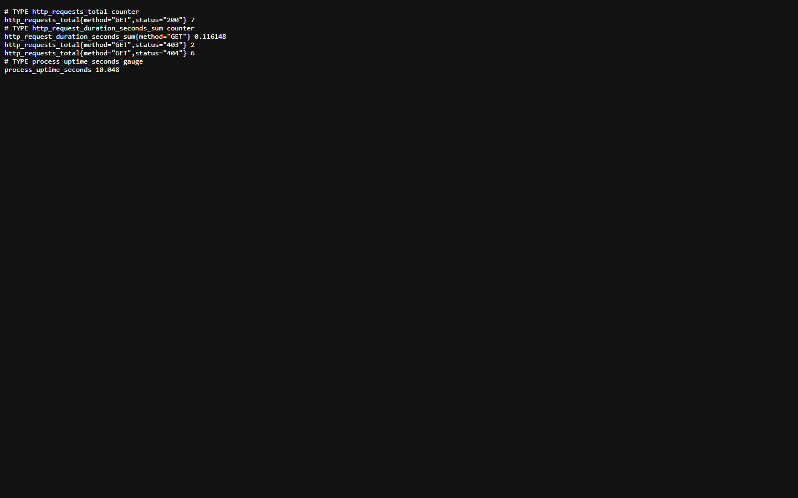
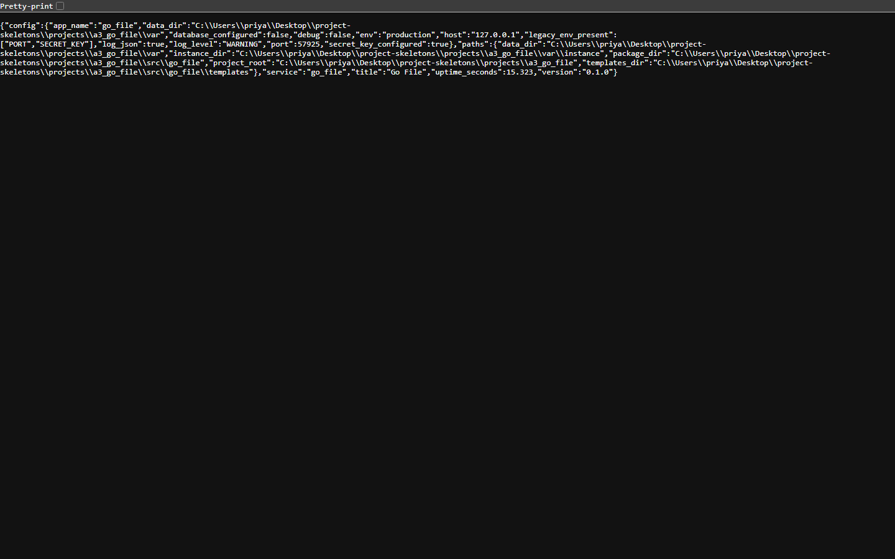

<p align="center">
  
</p>

<h1 align="center">dropforge</h1>

<p align="center"><b>Upload a file, get a link you can expire, password and cap.</b></p>

<p align="center">
  <a href="#quality-gates"></a> <a href="#quality-gates"></a> <a href="#api"></a> <a href="#requirements"></a> <a href="LICENSE"></a>
</p>

dropforge is a self-hosted file handoff: upload over HTTP, receive a short token, and control that link with a password, an expiry and a download limit. Every download is counted, and the share page says why a link stopped working.

---

**Contents** &nbsp;·&nbsp; [Why](#why-this-exists) &nbsp;·&nbsp; [What it does](#what-it-does) &nbsp;·&nbsp; [Quickstart](#quickstart) &nbsp;·&nbsp; [API](#api) &nbsp;·&nbsp; [Screenshots](#screenshots) &nbsp;·&nbsp; [Measured](#measured-not-estimated) &nbsp;·&nbsp; [Architecture](#architecture) &nbsp;·&nbsp; [Quality gates](#quality-gates) &nbsp;·&nbsp; [Deploy](#deploy) &nbsp;·&nbsp; [Limits](#limits-stated-rather-than-hidden)

## Why this exists

Sending a file should not mean uploading it to somebody else's bucket. The hard part is not the upload — it is the lifecycle: expiry that is enforced rather than displayed, a password that is checked server-side, and a cap that actually stops the fourth download.

## What it does

| Capability | How it works |
| --- | --- |
| **Short share links** | A random token per file; GET /s/<token> is the page, GET /dl/<token> is the bytes. |
| **Password-gated shares** | A locked link answers `need_password` until the password is supplied; the download route checks it again, so the file never leaves without it. |
| **Expiry and download caps** | Checked on every request; an exhausted link returns 410 with the reason, not a silent 404. |
| **Streamed uploads** | The file is written to disk as it arrives; large files do not sit in memory. |
| **List and delete** | GET /api/files and DELETE /api/files/<id> for cleanup, plus a CLI. |

## Quickstart

```sh
git clone https://github.com/scar8969/dropforge.git
cd dropforge
python -m venv .venv && . .venv/bin/activate   # Windows: .venv\Scripts\activate
pip install -e ".[dev]"
python wsgi.py                                 # http://127.0.0.1:8000
```

The same work from the CLI:

```sh
python -m go_file.cli --help
```

Commands: `put`, `ls`.

A first request:

```sh
curl -s http://127.0.0.1:8000/api/health | head
```

## Requirements

- Python **3.11+** — CI runs 3.11, 3.12 and 3.13.
- Runtime dependencies: `Flask>=3.0`, `Flask-SQLAlchemy>=3.1`, `SQLAlchemy>=2.0`, `PyYAML>=6.0`, `boto3`.
- No JavaScript build step: every page is server-rendered Jinja.

## API

Every route below is in [`openapi/dropforge.yaml`](openapi/dropforge.yaml) and is exercised by the live probe recorded in [`docs/EVIDENCE.md`](docs/EVIDENCE.md).

| Method | Path | What it does |
| --- | --- | --- |
| `GET` | `/api/health` | application health |
| `POST` | `/api/upload` | upload file |
| `GET` | `/s/<token>` | share page |
| `POST` | `/s/<token>` | unlock |
| `GET` | `/dl/<token>` | download |
| `GET` | `/api/files` | list |
| `DELETE` | `/api/files/<id>` | delete |

## Screenshots

Captured from the running service with headless Chromium at 1440×900, one image per page, committed under [`docs/assets/screens/`](docs/assets/screens/).

<table>
<tr>
<td width="50%"><br><sub><code>/files</code> &middot; 21.6 KB</sub></td>
<td width="50%"><br><sub><code>/healthz</code> &middot; 8.2 KB</sub></td>
</tr>
</table>

<table>
<tr>
<td width="50%"><br><sub><code>/livez</code> &middot; 7.3 KB</sub></td>
<td width="50%"><br><sub><code>/metrics</code> &middot; 16.2 KB</sub></td>
</tr>
</table>

<table>
<tr>
<td width="50%"><br><sub><code>/readyz</code> &middot; 7.7 KB</sub></td>
<td width="50%"><br><sub><code>/version</code> &middot; 26.1 KB</sub></td>
</tr>
</table>

## Measured, not estimated

These numbers were produced on this checkout by `pytest --cov` and by booting `wsgi.py` and issuing one real GET per documented path. The commands are in [`docs/EVIDENCE.md`](docs/EVIDENCE.md).

| Signal | Value |
| --- | --- |
| Tests | **132 / 132 passed** (18.5 s, exit 0) |
| Line coverage | **100.0%** — 754 of 754 statements |
| Source | 15 files / 1,596 lines |
| Test code | 14 files / 1,402 lines |
| Documented paths | 6 in the spec, 4 GET |
| Live probe | 13 GET requests to the booted app, **9 answered 200** |
| Median latency | **17.4 ms** (single uncached request, dev server) |
| Slowest / fastest | 53.9 ms `/` / 7.2 ms `/f/demo` |
| Bytes served | 15.9 KB across 13 responses |
| Screenshots | 7 captured |

## Architecture

```
dropforge/
├── src/go_file/
│   ├── http.py                         383  HTTP plumbing for go_file: correlation ids, access l
│   ├── config.py                       174  Environment-driven configuration for go_file
│   ├── observability.py                169  Structured logging and request correlation for go_fi
│   ├── _app.py                         151  
│   ├── app.py                          119  Application factory for go_file
│   ├── cli.py                          117  Command line client for go-file
│   ├── errors.py                       108  Typed application errors and their HTTP mapping for 
│   ├── share/api.py                    101  
│   ├── share/storage.py                 86  
│   ├── share/links.py                   80  
│   ├── models.py                        56  
│   ├── paths.py                         52  Filesystem layout for go_file
├── openapi/dropforge.yaml                 the contract of record
├── schema/dropforge.sql                   the DDL
├── tests/                       the suite that has to stay green
├── docs/EVIDENCE.md             the recorded live route walk
├── Dockerfile                   multi-stage build
└── wsgi.py                      entry point
```

The package keeps one shape across the service: `config.py` reads the environment once, `observability.py` emits structured JSON logs carrying a request id, `errors.py` turns exceptions into a single JSON envelope, `models.py` holds the tables, and the `share/` package holds the routes.

## Quality gates

| Gate | Command | Threshold |
| --- | --- | --- |
| Suite | `pytest -q` | all green |
| Coverage | `pytest --cov` | floor set in `pyproject.toml` from the measured value |
| Lint | `ruff check src tests` | zero findings |
| Format | `ruff format --check src tests` | zero reformats |
| Types | `mypy src` | zero errors |
| Security | `bandit -c pyproject.toml -r src` | reviewed skip list, no unreviewed finding |
| Live routes | boot `wsgi.py`, one GET per documented path | no 5xx, no undocumented guard |

CI runs the first six on Python 3.11, 3.12 and 3.13 for every push to `main`, plus a container build. See [`.github/workflows/ci.yml`](.github/workflows/ci.yml).

## Deploy

```sh
docker build -t dropforge .
docker run --rm -p 8000:8000 --env-file .env.example dropforge
```

Configuration is environment-only — every variable is documented in [`.env.example`](.env.example), and the service refuses to start with a production secret missing.

## Limits, stated rather than hidden

- Storage is local disk under the data directory; there is no S3 backend in this release.
- Download caps are counted per request, not per distinct client.

## License

MIT — see [LICENSE](LICENSE).
